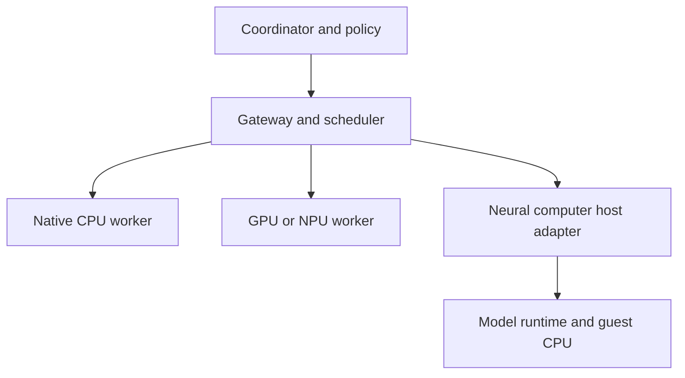

# Neural computers in distributed computing chains

## What participation means

A neural-computer instance can be modeled as a **logical worker** hosted by a real machine. It runs guest instructions through a model runtime and exposes operations through a host-side adapter. The host adapter, not an assumed guest NIC, handles authentication, transport, resource accounting, cancellation and persistence. Ordinary CPU workers, GPU/NPU workers, external WASM runtimes and neural-computer workers can share a control protocol while advertising very different capabilities.

This is an architecture proposal. There is no existing MimirAlloc network or implementation here. A network of neural computers does not automatically combine RAM into one coherent address space, and an LLM's natural-language response is not a reliable binary protocol.

## Layered architecture

Each worker reports a versioned capability descriptor. Requests are explicit RPC or equivalent structured messages, with deadlines and quotas. A guest address is never sent as if it were globally valid. Transfers require validated object handles, bounded offsets, byte counts and a documented ownership rule.

## Capabilities to advertise

- Worker identity, adapter protocol version and authentication domain.
- Execution kind: native, external VM, transformer-WASM or model-embedded RISC-V; model revision and firmware hash.
- Guest ISA subset, ABI, endianness, supported operation set and available host I/O bridge.
- Maximum guest arena and currently allocatable bytes, if a trustworthy API is implemented; separate weights, host RAM and accelerator memory budgets.
- Actual state persistence, checkpoint format/version, snapshot and restore support, maximum input/output and trace lengths.
- Verified numerical precision, runtime/kernel configuration and evidence tier for the tested workload.
- Supported transports, retry semantics, concurrency, cancellation, isolation, quotas and failure reporting.
- Performance estimates qualified by hardware and workload. A slow experimental node can still be useful for verification or research.

Capabilities are declarations, not proof. The scheduler should run an attestation or conformance test appropriate to its threat model, record results and reject unsupported requirements.

## Work and resource model

A task can ask for `required ISA`, program hash, input object IDs, resource budget, deadline, deterministic-execution requirement and output verification policy. The scheduler chooses only workers meeting *hard* requirements. The host adapter translates accepted requests into validated guest input, runs the machine and returns a structured result with status and evidence. Where no byte-buffer interface exists, use the published bounded text/trace bridge and account for its cost; do not invent direct state access.

Memory services may expose immutable, versioned chunks or explicit allocations `(object_id, generation, bounds, permissions, lease)` managed by a trusted provider. Guest memory remains local to the guest unless the adapter copies or translates data. There is no automatic shared pointer, automatic coherence or atomicity across devices.

## A safe lifecycle

1. Register worker and pin model/firmware/runtime hashes; run a small known-answer test.
2. Request capacity reservation with caller identity, request ID, maximum bytes and deadline. Admission may reject a job.
3. Transfer input in bounded chunks with lengths and integrity checks; a checksum detects accidental corruption, while authenticated transport and authorization address different threats.
4. Initialize guest state and run with instruction/trace, time, memory and output limits. Mark state-changing operations with a monotonically increasing epoch where applicable.
5. Produce result plus executor version, input hash, exit/fault status, output hash and resource metrics. Verify with a reference or second independent implementation for tasks requiring exact results.
6. Revoke capability, stop new operations, wait for outstanding requests/guest work and reclaim resources. Persist checkpoints only if explicitly requested and supported.

A timeout is not proof the remote operation failed. Retries require idempotency keys or transaction identifiers; otherwise a duplicated allocation or state change may occur. A lease expiry alone is insufficient if stale workers can still access data. Fencing epochs must be enforced at the authority that accepts operations, and already-issued requests must be accounted for.

## Snapshot and migration

Pause guest execution at a defined safe point, capture guest registers/memory, model-specific recurrent/attention state, input cursor, runtime version and outstanding I/O. Persist atomically with integrity metadata, then restore only to a compatible worker after validation. Do not claim live migration across models, dtypes, kernels or devices without bit-exact restore tests; some state may be backend-specific. A checkpoint may contain private prompts, model state or program data and needs protection appropriate to the deployment.

## Candidate chain patterns

1. **Native coordinator → neural validator:** conventional worker computes a small reference result; neural-computer worker executes the same deterministic test and returns a comparison artifact.
2. **Neural guest → native service:** guest emits a bounded request through its actual bridge; host validates it and obtains an immutable data chunk from a service. The result is copied into guest memory through a documented mechanism.
3. **Multi-worker inference pipeline:** an application routes tasks among heterogeneous nodes; model execution and KV state follow each runtime's explicit APIs. This is application orchestration, not transparent heap sharing.
4. **Distributed allocator study:** clients submit allocate/free operation logs to independent guest implementations and compare results, with generation and ownership checked at each endpoint.

## Feasibility and economics

For small guest buffers, serialization and model decode can dominate useful computation. Compare end-to-end latency and cost with native CPU, conventional emulator and hosted WASM for the same deterministic job. Record transfer time, tokens, energy, GPU occupancy and failures. A positive result may be research novelty, verifiability or integration utility rather than speed. Do not infer energy efficiency or cost benefit from the existence of an in-model processor.

## Sources

- [Qwenputer repository](https://github.com/divagr18/qwenputer)
- [Transformer VM repository](https://github.com/Percepta-Core/transformer-vm)
- [Linux RDMA user verbs](https://docs.kernel.org/infiniband/user_verbs.html)
- [Linux CXL documentation](https://cxl.docs.kernel.org/)
